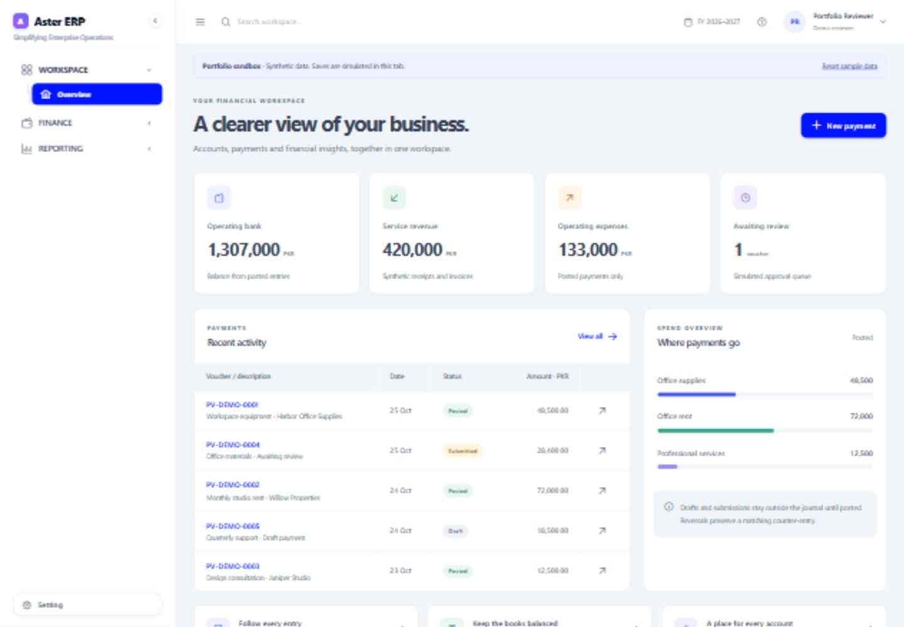
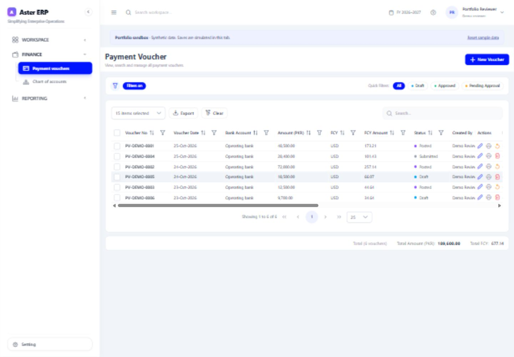
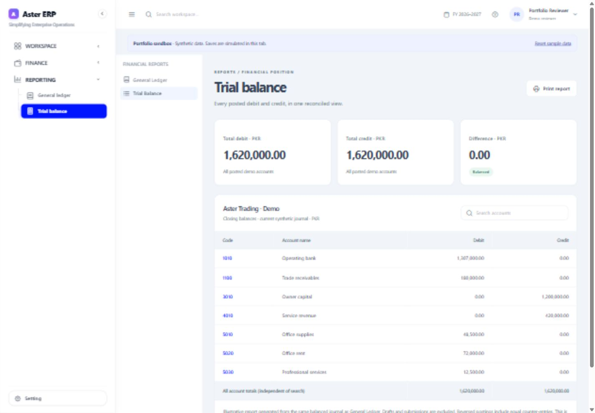

# Aster ERP

**A clear, connected workspace for finance.**

An Angular 21 ERP frontend with an isolated portfolio sandbox: browse payment
vouchers, explore a General Ledger, and reconcile a synthetic Trial Balance.

> Demo operations are simulated in your browser tab. This project has no
> production database, banking integration, or production accounting backend.



## Explore the workspace

1. Start the app and choose **Explore demo workspace**.
2. Confirm the open financial year.
3. Browse Payment vouchers, open a draft, and edit its detail rows.
4. Save a simulated draft or submission, or inspect a posted voucher's print view.
5. Select Operating bank in General Ledger and apply the date filter.
6. Review Trial Balance and the read-only Chart of Accounts.
7. Use **Reset sample data** to restore the fixtures.

No registration, real password, backend account or external API is required.

## Technology

Angular 21 standalone components · PrimeNG 21 · NgRx Store/Effects · Angular
Signals · RxJS · TypeScript · Tailwind CSS 4 · SCSS · decimal.js · Jasmine/Karma.

The application is a static SPA suitable for Vercel. Components and feature
routes load on demand; no SSR or server-side application is included.

## What is implemented

| Area | Portfolio behavior |
| --- | --- |
| Overview | Bank balance, revenue, posted expenses, pending submissions and recent activity derived from synthetic data. |
| Payment vouchers | Search/filter/pagination, detail editor, currency and gross-up tax previews, local draft creation/update/delete, simulated submission, posted-voucher reversal, print preview. |
| General Ledger | Account, party and date filters; opening/movement/closing balances; cancellation of stale requests; pagination; search within the loaded page; printing. |
| Trial Balance | Synthetic posted account balances derived from the same journal, search, balance check and print. |
| Chart of Accounts | Read-only synthetic account directory and balances. |
| Approval / audit | Read-only simulated approval preview and synthetic audit record. |
| Session | Separate demo authentication namespace, required financial year, logout, scoped API credentials and coordinated refresh. |

A draft or submission does not affect the demo journal. Posted fixtures do.
Reversals preserve the original record and append equal counter-entries.

## Screenshots

| Vouchers | Trial Balance |
| --- | --- |
|  |  |

All screenshots use fictional demo content.

## Run locally

Use Node 24 LTS (or a supported Node 22 release, at least 22.12).

```sh
npm ci
npm start
```

Open `http://localhost:4200`.

```sh
npm run build
npm run preview
```

Production preview: `http://127.0.0.1:4173`. Build output:
`dist/aster-erp/browser`.

## Configuration

The build/start preparation script writes `public/app-config.js` from these
**public, non-secret** optional environment values:

| Variable | Default | Purpose |
| --- | --- | --- |
| `ASTER_DEMO_MODE` | `true` | Enable the isolated synthetic sandbox. |
| `ASTER_API_URL` | `/api` | Base URL for a separately hosted backend when demo is disabled. |

`.env.example` documents the inputs; Node scripts do not silently load `.env`.
For an explicit local file, use `node --env-file=.env scripts/configure.mjs`,
then `npx ng serve`. Normal `npm start` and `npm run build` regenerate settings
from their process environment. Vercel supplies project environment values at
build time. The generated file can also be changed after deployment.

To connect a live backend, set `ASTER_DEMO_MODE=false` and your own API URL.
Update the `connect-src` security policy in `vercel.json` to allow that API,
and configure backend CORS for the frontend origin. Never place a password,
server key, database URL or private token in browser configuration.

## Quality checks

```sh
npm run typecheck
npm run lint
npm run scan
npm test -- --watch=false --browsers=ChromeHeadless --progress=false --reporters=dots
npm run audit:production
npm run build
```

Tests require Chrome/Chromium. The generic GitHub workflow runs installation,
typechecking, lint, source scanning, build, headless tests and a production
dependency audit with read-only repository permissions.

See [the readiness report](docs/READINESS.md) for actual results, measured
bundle changes, residual development-tool advisories and browser checks.

## Architecture and workflows

- [Architecture and session boundaries](docs/ARCHITECTURE.md)
- [Financial behavior and limitations](docs/FINANCIAL-WORKFLOWS.md)
- [Vercel deployment and live API requirements](docs/DEPLOYMENT.md)
- [Initial engineering audit](docs/AUDIT.md)
- [Contributor guidance](CONTRIBUTING.md)
- [Sanitization record](SANITIZATION.md)

## Known limitations

The demo is not a production backend. Its local state is not multi-user or
durable, and client guards are not authorization boundaries. File uploads and
downloads, real approval actions, linked-document operations, registration,
password reset, Journal/Receipt Voucher management and a live Trial Balance API
are not connected. Sample ledger/company IDs are not a production tenant model.

The existing discount convention adds discount to the voucher's gross amount.
Multiple withholding rates have a documented consistency question; neither
should be generalized as universal accounting rules. The server must validate
and authoritatively calculate real financial postings.

## Provenance and portfolio contributions

This is an authorized portfolio adaptation of an existing enterprise frontend,
not a claim of sole authorship of the original application. Its upstream
PrimeNG/Sakai template copyright notice remains in [LICENSE.md](LICENSE.md).

The portfolio preparation adds the isolated synthetic adapter, finance overview,
demo account and Trial Balance views, authentication reliability fixes, decimal
precision helpers, route splitting, focused tests, accessibility improvements,
repository documentation and deployment configuration. Existing finance
components and API contracts are adapted and retained.

The retained upstream MIT notice covers the upstream material under its terms.
This portfolio preparation does not independently relicense employer-origin
extensions or certify their ownership. Publication authorization was explicitly
confirmed by the project owner.
